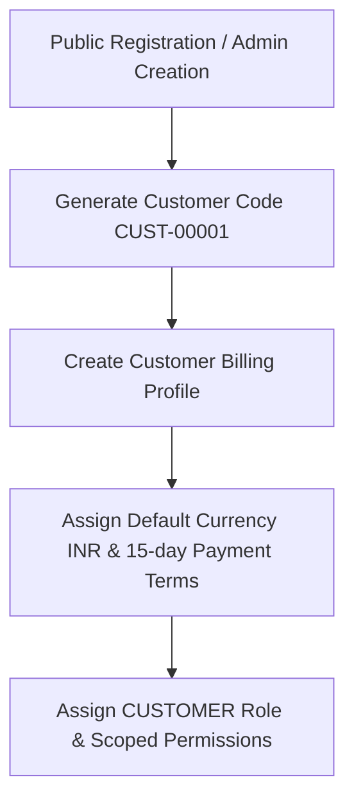
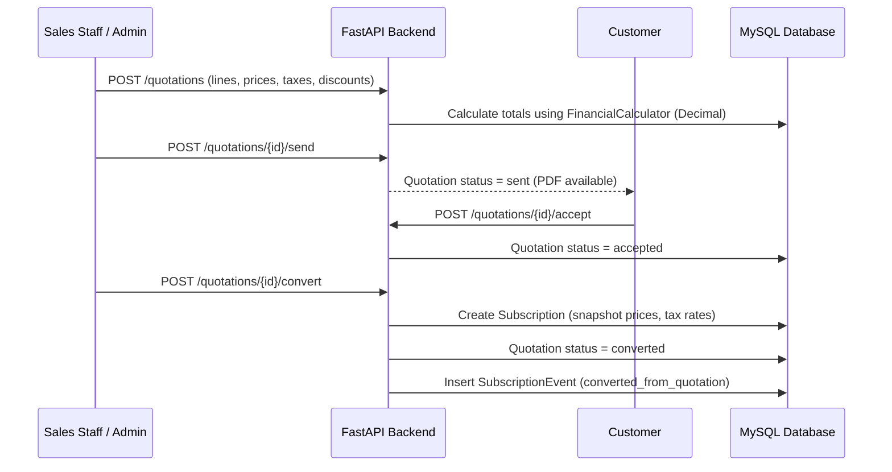

# Business Workflows & Execution Rules

This document outlines the core business workflows implemented in Brightloop Subscription Management System.

---

## 1. Customer Onboarding & Registration

- When a customer registers publicly or is created by Sales Staff, the system generates an sequential customer code `CUST-xxxxx`.
- The customer profile is linked to an authenticated user account.
- Backend dependencies verify that customers cannot access other customers' invoices, subscriptions, or administrative endpoints.

---

## 2. Quotation Negotiation & Subscription Conversion

1. **Authoritative Calculation:** Line subtotals, item discounts, tax snapshots, and grand totals are calculated authoritatively on the backend using Python's `Decimal` module to prevent rounding drift.
2. **Tax Snapshotting:** When a quotation converts to a subscription, the effective tax rate is captured in `subscription_lines.tax_snapshot`. Future recurring billing uses this snapshot to generate accurate tax invoices.

---

## 3. Recurring Billing Engine & Calendar Clamping

The recurring billing engine runs continuously via Celery Beat or ad-hoc triggers.

### Month-End Clamping Logic
- Subscriptions starting on January 31st that bill monthly will bill on:
  - February 28th (or 29th on leap years)
  - March 31st
  - April 30th
- The engine uses calendar clamping (`calendar.monthrange`) to prevent day overflow.

### Idempotency & Period Locking
- Every billing cycle checks `subscription_billing_periods`.
- An invoice is created only if no billing period record exists for that subscription and date window.
- This guarantees **zero duplicate invoices** even under network retries or concurrent background workers.

---

## 4. Payment Processing (Manual & Razorpay Online)

### Online Payment (Razorpay Checkout)
1. Customer clicks **Pay with Razorpay** on an unpaid invoice in the Customer Portal.
2. Frontend calls `POST /api/v1/payments/online/order` with `invoice_id`.
3. Backend converts `balance_due` into paise (`int(amount * 100)`) and calls Razorpay API to generate an `order_id`.
4. Razorpay modal opens on customer screen with prefilled contact info.
5. On payment completion, Razorpay returns `razorpay_payment_id`, `razorpay_order_id`, and `razorpay_signature`.
6. Frontend submits these to `POST /api/v1/payments/online/verify`.
7. Backend verifies HMAC SHA256 signature using `settings.RAZORPAY_KEY_SECRET`.
8. On verification, `PaymentService.record_online_payment()` records the transaction, allocates funds to the invoice, adjusts `amount_paid`, and sets invoice status to `paid` or `partially_paid`.

### Manual Payment
- Finance staff can record bank transfers, cheques, and offline payments through `POST /api/v1/payments/manual`.
- Allocations are updated atomically in the database within a transaction.

---

## 5. Refunds & Invoice Reconciliations
- Refunds can be issued via `POST /api/v1/payments/refund` with a reason.
- For Razorpay transactions, the adapter calls the Razorpay Refund API.
- The refunded amount decreases the settled allocation and restores the invoice's `balance_due`.
- All operations are permanently audited in the `audit_logs` table.

